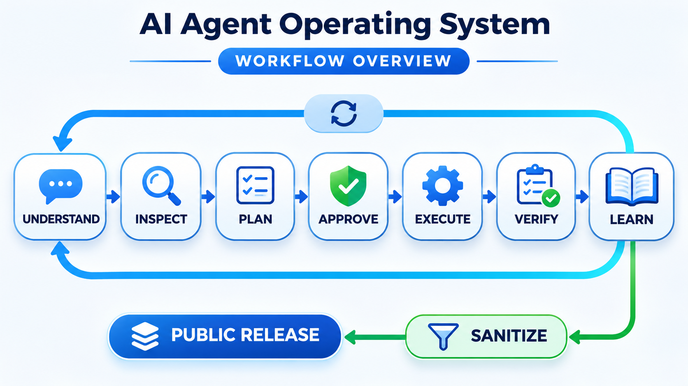

# Day Dev Public Skill

ชุดระบบทำงานสำหรับ AI coding agent ที่รวม workflow แบบปรึกษาก่อนทำ, memory ที่ตรวจสอบแหล่งที่มาได้, progress หลายงาน, autonomous improvement ที่มีขอบเขต และเว็บ Skill Brain 3D



Day Dev เปลี่ยน agent จากผู้ช่วยที่ตอบเป็นครั้ง ๆ ให้เป็นระบบทำงานที่มีขั้นตอน ความจำ หลักฐาน การตรวจผล และวงจรเรียนรู้
โดยแยก **Private workspace brain** ออกจาก **Public reusable skill** อย่างชัดเจน: private เก็บบริบทจริง ส่วน repository นี้
เก็บเฉพาะ workflow/template ทั่วไปที่ผ่านการ sanitize แล้ว

## ภาพรวมสถาปัตยกรรม

```text
คำขอผู้ใช้
   ↓
Understand → Inspect → Plan → Approve → Execute → Verify → Learn
                                                      ├─→ Private memory/progress/log
                                                      └─→ Sanitize → Public reusable skill
```

- `main_skill.md` เป็น router หลัก
- `work_flow_skill.md` เป็นวงจรทำงานตั้งแต่เข้าใจงานจนเรียนรู้กลับ
- `*_skill.md` แยกกฎตามโดเมน ไม่ยัดทุกเรื่องไว้ไฟล์เดียว
- `memory/` เป็น template ความจำที่มี provenance/freshness/lifecycle
- `scripts/` ตรวจโครงสร้างและช่วยจัด progress/memory
- `brain_3d/` แสดงความสัมพันธ์ของ skill และ memory แบบ interactive

## หลักการทำงาน

1. อ่านสถานะด้วย `scripts/list_active_progress.sh`
2. อ่าน `main_skill.md` แล้วเดินตาม `work_flow_skill.md`
3. สำรวจแบบ read-only เพื่อเข้าใจระบบจริง
4. ก่อนสร้าง/แก้/เพิ่ม/ลบ ให้คุยผลลัพธ์ จุดกระทบ เงื่อนไข ความเสี่ยง และวิธีตรวจ
5. เมื่อผู้ใช้ยืนยันด้วย “ทำเลย/ทำตามนี้/ทำอัตโนมัติ” ให้ลงมือต่อใน scope โดยไม่ถามเรื่องเดิมซ้ำ
6. ตรวจผล บันทึก progress/work log/change manifest และจำเฉพาะความรู้ที่มีคุณภาพ

การอนุมัติ implementation ไม่เท่ากับการอนุมัติ action ที่เสี่ยงหรือกระทบภายนอก หากต้องลบข้อมูลสำคัญ, deploy production, ส่งข้อความ, เผยแพร่ หรือขยาย scope อย่างมีนัยสำคัญ ต้องหยุดตาม `permission_skill.md`

## โหมดทำงานอัตโนมัติ

ผู้ใช้ให้ standing authorization แก่งานหนึ่งได้ เช่น “ทำอัตโนมัติไปเรื่อยจนดีหรือจนฉันบอกพัก” Agent ต้องกำหนด scope, metric, regression checks และ stopping rules ตาม `continuous_improvement_skill.md` แล้วทำเป็นรอบ:

`inspect → propose/approve → change → verify → record → next iteration`

หยุดเมื่อผู้ใช้บอกพัก, budget หมด, metric ไม่ดีขึ้น, เกิด regression หรือพบ action ใหม่ที่อยู่นอก authorization

## ความจำ

`memory/` มีเฉพาะ template สาธารณะ ไม่มีข้อมูลส่วนตัวของผู้สร้าง

- `BRAIN_INDEX.md` — แผนที่ความจำ
- `USER_MEMORY.md` — preference ที่ผู้ใช้ยืนยัน
- `DECISION_MEMORY.md` — การตัดสินใจและเหตุผล
- `MEMORY_INBOX.md` — candidate ที่ยังรอตรวจ
- `SOURCE_LEDGER.md` — provenance/freshness
- `PROGRESS*.md` — งานที่กำลังทำ แยกไฟล์ต่องาน
- `WORK_LOG.md` — ledger งานที่เสร็จ
- `CHANGES.md` — create/edit/delete ที่รอ deploy

เพิ่ม candidate อย่างปลอดภัย:

```bash
skill/day_dev_public/scripts/capture_memory.sh preference user-confirmed \
  "สรุปความชอบ" "conversation reference"
```

## Skill Brain 3D และ Work Mode

ชุดนี้มีเว็บแสดงความสัมพันธ์ของ skill/memory และ Docker service มาตรฐานชื่อ `skill_brain_3d`:

```bash
cd skill/day_dev_public
docker compose config --quiet
docker compose up -d skill_brain_3d
open http://localhost:3004
```

Compose มี mapping `3004:3004`, healthcheck และ relative mount จึงย้ายไป workspace อื่นได้ คำสั่ง trigger “โหลดทำงาน” ใช้ flow ใน `work_mode_skill.md`: ตรวจ Docker → ตรวจ/ซ่อม compose ตามสิทธิ์ → start service → รอ healthy → เปิดหน้าเว็บ

## ติดตั้ง

```bash
git clone https://github.com/nattapatwakhet/Skill_Day_Dev_MD_Public.git skill/day_dev_public
```

จากนั้นนำ `AGENTS.md` หรือ `CLAUDE.md` ไปไว้ root ของ workspace หรือคัดเฉพาะคำสั่ง entry ที่เหมาะกับ agent ที่ใช้
หากติดตั้ง path อื่นให้แก้ prefix ใน entry file

โครงสร้างสำคัญ:

```text
skill/day_dev_public/
├── AGENTS.md
├── CLAUDE.md
├── main_skill.md
├── work_flow_skill.md
├── *_skill.md
├── memory/
├── scripts/
├── brain_3d/
└── docker-compose.yml
```

## ตรวจสุขภาพก่อนเผยแพร่

```bash
skill/day_dev_public/scripts/validate_public.sh
cd skill/day_dev_public/brain_3d && npm run build
```

Validator ตรวจไฟล์จำเป็น, consultation-first contract, privacy markers, Markdown links, index coverage และ Docker Compose syntax

## Public-safe policy

ห้ามบันทึก local absolute path, อีเมล/ตัวตน, รายชื่อโปรเจกต์ภายใน, production host, credential, token, secret หรือ memory จริงของผู้ใช้ลง repository นี้ ใช้ placeholder และ template เท่านั้น ไฟล์ `.git/` เป็น metadata ของ repository และอยู่นอก content scan

## Private → Public sync

1. diff private และ public เพื่อหา generic delta
2. แยก rule/pattern ออกจากประวัติและข้อมูลเฉพาะงาน
3. rewrite/sanitize ชื่อบุคคล path โปรเจกต์ host credential และค่าจริง
4. ตรวจ conflict, freshness, provenance และลิงก์
5. อัปเดต README/ภาพ/ตัวอย่างเมื่อวิธีใช้เปลี่ยน
6. รัน validator และ build ก่อน publish

Public ไม่ใช่สำเนาทั้งหมดของ private แต่เป็น “ฉบับแจกจ่าย” ที่รักษาความสามารถทั่วไปโดยไม่เผยบริบทของเจ้าของ

## English overview

Day Dev Public is a portable operating system for AI coding agents. It provides a structured loop—understand, inspect,
plan, approve, execute, verify, and learn—along with provenance-aware memory, concurrent progress tracking, bounded
autonomous improvement, validation scripts, and a Dockerized 3D skill graph.

The public repository is a sanitized distribution derived from a private working brain. It contains reusable workflows,
templates, and examples only; personal memory, internal project context, credentials, and production configuration remain
private. Clone the repository into `skill/day_dev_public/`, place the appropriate `AGENTS.md` or `CLAUDE.md` entry file
at your workspace root, and run `scripts/validate_public.sh` before publishing changes.

## License

MIT
